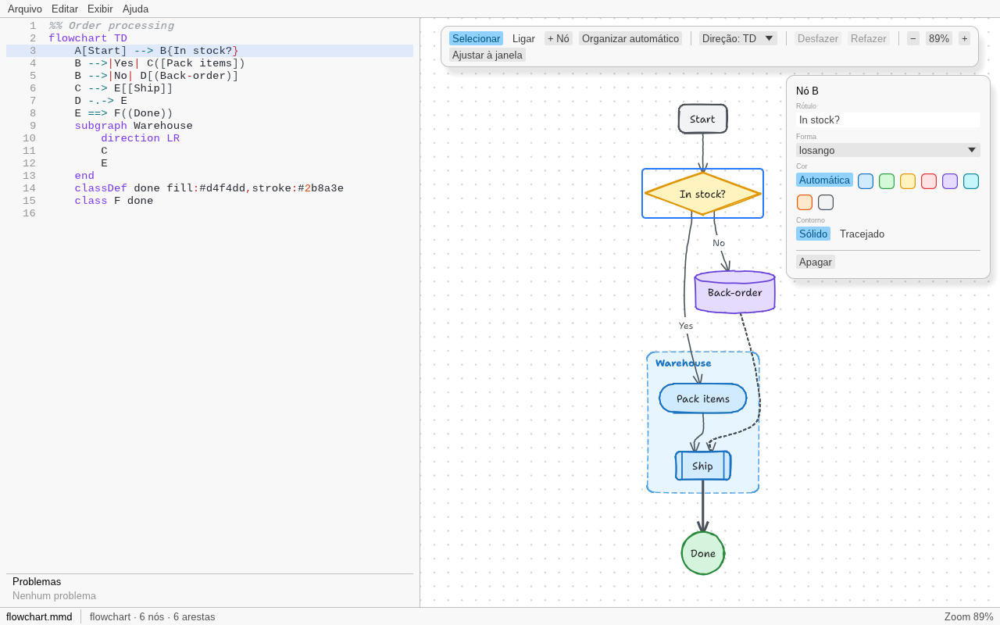
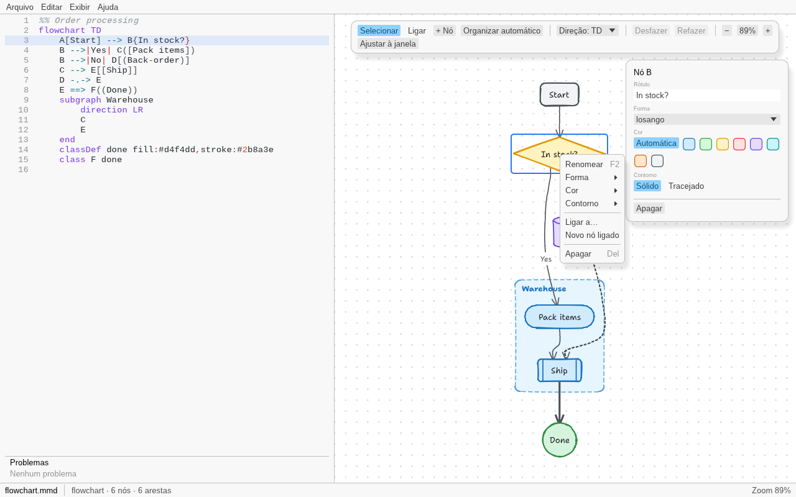
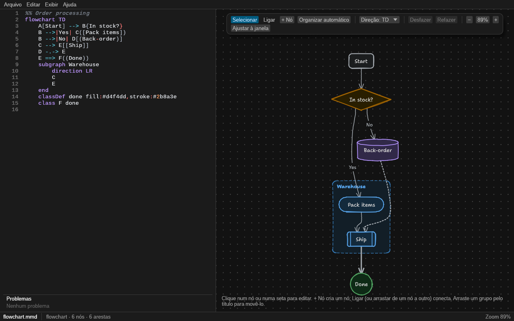

# MermaidCraft

Editor nativo de diagramas [Mermaid](https://mermaid.js.org) para macOS, Linux e Windows, escrito em Rust. O texto e o
desenho ficam lado a lado e andam juntos: o que se faz no desenho vira texto Mermaid, e o arquivo
continua sendo Mermaid puro, que abre em qualquer lugar.



## O que ele faz

- **Visual desenhado à mão**, no estilo do Excalidraw: fontes manuscritas legíveis, cores claras
  com significado (por grupo ou pelo papel da forma), hachura opcional e setas em grafite. Tudo
  personalizável em **Exibir › Aparência**, inclusive um visual clássico do Mermaid.
- **Layout legível em diagramas longos**: rótulos quebram em linhas, setas desviam dos nós, setas
  que chegam ao mesmo lado entram em pontos separados e rótulos de seta procuram um lugar livre.
- **Notas ao lado dos nós**: um nó solto ligado por `-.-` (ou `---`) a um nó de um grupo fica ao
  lado dele, dentro do grupo.
- **Edição pelo desenho**: criar e ligar nós, trocar rótulo, forma, cor e contorno num painel de
  estilo, arrastar nós e grupos inteiros (pela faixa do título). Cada mudança é um passo de
  desfazer, e a linha alterada no texto pisca.
- **Menu de botão direito**: sobre um nó, renomear, forma, cor, contorno, ligar a outro nó, criar
  um nó já ligado e apagar; sobre uma seta, rótulo, linha, ponta, inverter o sentido e apagar; no
  espaço vazio, criar um nó no ponto clicado, organizar, ajustar à janela e trocar a direção.
  F2 ou Enter abrem o rótulo do selecionado, e Delete apaga.
- **Texto e desenho ligados**: selecionar um nó mostra a linha dele; pôr o cursor numa linha
  seleciona o nó.
- **Tema escuro**, inclusive no desenho. Os arquivos exportados continuam claros.
- **Exporta** SVG, PNG e PDF, e lê os blocos ` ```mermaid ` de arquivos Markdown.





Diagramas suportados: `flowchart`/`graph`, `sequenceDiagram` e `erDiagram`.

## Instalação

Requer Rust (edição 2024) e, para o app, macOS 11+, Linux com Wayland ou X11, ou Windows 10+.
Não há binários prontos: o app é compilado na própria máquina.

**macOS**

```sh
packaging/macos/package.sh          # gera target/macos-package/MermaidCraft.app e bin/
ditto target/macos-package/MermaidCraft.app /Applications/MermaidCraft.app
cp target/macos-package/bin/mermaidcraft-cli ~/.local/bin/
```

Sem `MACOS_SIGN_IDENTITY`, o pacote sai com assinatura ad-hoc, que vale só para a própria máquina.

**Linux**

```sh
packaging/linux/package.sh --install   # compila, gera dist/release/*.tar.gz e instala em ~/.local
```

Instala `mermaidcraft` e `mermaidcraft-cli` em `~/.local/bin` (outra pasta com `--prefix`), o
atalho no menu de aplicativos, o ícone e o tipo de arquivo `.mmd` (abrir pelo gerenciador de
arquivos). Sem `--install`, só gera o `.tar.gz`; para instalá-lo à mão:

```sh
tar xzf dist/release/mermaidcraft-*.tar.gz -C ~/.local --strip-components=1
update-mime-database ~/.local/share/mime
update-desktop-database ~/.local/share/applications
```

As bibliotecas de Wayland e X11 são carregadas ao abrir o app, então a compilação só precisa do
Rust; com `inkscape` ou ImageMagick, entram também ícones PNG.

**Windows** (PowerShell)

```powershell
powershell -ExecutionPolicy Bypass -File packaging\windows\package.ps1
```

Gera `target\windows-package\MermaidCraft\` (`MermaidCraft.exe` e `mermaidcraft-cli.exe`) e um
`.zip`. Copie a pasta para onde quiser (por exemplo `%LOCALAPPDATA%\Programs\MermaidCraft`) e
ponha-a no `PATH` para usar o CLI no terminal. O `MermaidCraft.exe` abre sem janela de console, e
por isso `--help` e `--version` não aparecem no terminal; use o `mermaidcraft-cli` para isso.

As preferências ficam em `~/Library/Application Support/MermaidCraft` (macOS),
`~/.config/mermaidcraft` (Linux, ou `$XDG_CONFIG_HOME/mermaidcraft`) e `%APPDATA%\MermaidCraft`
(Windows).

## Linha de comando

O `mermaidcraft-cli` faz tudo sem janela:

```sh
mermaidcraft-cli check diagrama.mmd                    # valida (sai com 1 se houver erro)
mermaidcraft-cli info diagrama.mmd --detail            # tipo, nós, arestas e erros em JSON
mermaidcraft-cli render diagrama.mmd -o diagrama.svg   # SVG, PNG (--scale 2) ou PDF
mermaidcraft-cli render doc.md --block 2 -o fig.png    # um bloco de um Markdown
mermaidcraft-cli new flowchart -o novo.mmd             # diagrama inicial
```

O visual segue o que foi escolhido no app; `--look clean`, `--font`, `--colors`, `--fill`,
`--stroke` e `--arrows` mudam uma parte dele. `MERMAIDCRAFT_SETTINGS` aponta para outro arquivo de
preferências.

## Servidor MCP

`mermaidcraft-cli mcp` roda um servidor [MCP](https://modelcontextprotocol.io) por stdio, para
agentes criarem, lerem, validarem, editarem e desenharem diagramas: `diagram_create`,
`diagram_read`, `diagram_write`, `diagram_info`, `diagram_validate`, `diagram_render`,
`flowchart_create`, `flowchart_edit` e `markdown_blocks`. No Claude Code:

```sh
claude mcp add --scope user mermaidcraft -- ~/.local/bin/mermaidcraft-cli mcp
```

## Posições guardadas no arquivo

Nós e grupos arrastados guardam o deslocamento num comentário no fim do arquivo, que outros
leitores de Mermaid ignoram:

```
%% mermaidcraft:layout B=-120,40 sub:ENTRADA=0,80
```

**Organizar automático** apaga esse comentário e volta ao layout calculado.

## Estrutura

| Pasta | Conteúdo |
|---|---|
| `crates/engine` | Parser, modelo, layout em camadas, cena e saída SVG/PNG/PDF, edições do texto |
| `crates/cli` | Linha de comando e servidor MCP |
| `src` | App (eframe/egui) |
| `docs` | Documentos de cada funcionalidade |
| `packaging` | Empacotamento por sistema (`macos`, `linux`, `windows`) |

Testes: `cargo test --workspace`. Lints: `cargo clippy --workspace --all-targets -- -D warnings`.

## Licença

MIT. As fontes embutidas (Shantell Sans, Patrick Hand, Kalam, Architects Daughter e Liberation
Sans) têm licença própria, em `assets/fonts/`.
